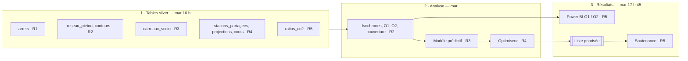

# Plan de projet — Hackathon Mobility × Citiz

> Du lundi 19 au mercredi 21 octobre 2026 · gel du code **mercredi 10 h** · soutenance **mercredi après-midi**
> Référence unique : le sujet officiel *Hackathon Mobility – From open data to location decisions* (EPITECH, v0.4.0).
> Légende : **[F]** fait tiré du sujet ou mesuré · **[H]** hypothèse à vérifier · **[R]** recommandation de l'équipe

## Sommaire

1. [Objectif et livrables](#1-objectif-et-livrables)
2. [Territoire retenu : Auvergne-Rhône-Alpes](#2-territoire-retenu--auvergne-rhône-alpes)
3. [Périmètre (MVP)](#3-périmètre-mvp)
4. [Calendrier et points de contrôle](#4-calendrier-et-points-de-contrôle)
5. [Rôles](#5-rôles)
6. [Nettoyage des données : règles communes](#6-nettoyage-des-données--règles-communes)
7. [Fiches par rôle](#7-fiches-par-rôle)
8. [Parcours des données](#8-parcours-des-données)
9. [Risques et parades](#9-risques-et-parades)
10. [Indicateurs de suivi](#10-indicateurs-de-suivi)
11. [Décisions](#11-décisions)
12. [Sources](#12-sources)

---

## 1. Objectif et livrables

**Objectif [F]** : transformer l'open data en un outil d'aide à la décision qui indique où Citiz doit ouvrir de nouvelles stations d'autopartage et, plus largement, où ajouter un arrêt de bus ou une station vélo, pour toucher le plus d'habitants au moindre coût.

| Objectif | Ce qu'il faut produire | Table |
|---|---|---|
| **O1 – Diagnostic** | Carte où chaque carreau est coloré selon le nombre d'options de transport accessibles **par habitant à 5 min de marche** (réseau piéton réel, pas un cercle). | `gold_o1` |
| **O2 – Qui est concerné** | Chaque type de station ou d'arrêt sur la carte, avec la **population desservie** par chacun. | `gold_o2` |
| **O3 – Décision (cœur)** | (a) valeur d'un emplacement estimée par un **modèle prédictif**, (b) **coût par type d'équipement**, (c) **liste priorisée sous budget** tenant compte de l'offre existante. | `gold_scores`, `couts`, liste priorisée |

**Livrables [F]** (tous sur ce dépôt) : le code, les slides, la liste des sources (`SOURCES.md`).

**Évaluation [F]** : démo live sur données réelles ; argumentaire non technique (problème, recommandation chiffrée, apport pour Citiz) ; argumentaire data scientist (choix justifiés, modèle évalué, limites) ; volet éthique (CO₂, équité, stigmatisation, vie privée). **Chaque membre doit pouvoir expliquer tout le projet.**

---

## 2. Territoire retenu : Auvergne-Rhône-Alpes

Décision **D1** : Auvergne-Rhône-Alpes (région 84), avec Lyon comme grande ville (choix d'équipe du 19/10). Analyse : `eda-citiz/` ; mesures du 19/10/2026 (flux GBFS, geo.api.gouv.fr, Omphale) dans `data/silver/*_qc.txt`.

| Indicateur | Auvergne-Rhône-Alpes |
|---|---|
| Communes · population · surface | 4 025 · 8,2 M hab. · 70 900 km² · 12 départements |
| Stations Citiz publiques | **619** (Alpes Loire 409, Métropole de Lyon 200, Auto-en-Velay 9, Citiz Développement 1), 1 405 places, 990 véhicules disponibles au relevé |
| Communes avec au moins une station Citiz | **129** ; Lyon 148, Grenoble 125, Chambéry 33, Villeurbanne 22, Annecy 19, Saint-Étienne 19, Valence 13 |
| Communes < 20 000 hab. avec station | **98** (165 stations) ; 68 communes n'ont qu'une station |
| Stations Citiz / 100 000 hab. | 7,5 |
| Vélos en libre-service, en stations | 901 stations : Vélo'v Lyon (465), VéliVert Saint-Étienne (101), C Vélo Clermont (82), Velonecy Annecy (79), Libélo Valence (67)… |
| GTFS retenus (Rôle 1) | 18 réseaux : TCL, TAG, STAS, T2C, Synchro, Sibra, Citéa, Cars Région… (`scripts/build_arrets.py`) |
| Croissance Omphale 2021 → 2030 (central) | **+3,3 %** ; Ain +5,7 %, Haute-Savoie +5,3 %, Rhône +4,7 % ; Allier −2,7 %, Cantal −2,1 % |

**Pourquoi Auvergne-Rhône-Alpes** (EDA Citiz)

1. **Seule région avec les quatre types de territoire** (très grande ville, métropoles, villes moyennes, petites communes / rural).
2. **Trois fois plus de stations hors grandes villes** que les autres régions candidates (289 contre 87 au mieux) : de quoi apprendre le modèle d'usage.
3. **Tout le sujet est couvert** : Citiz, bus, tram et cars régionaux, nombreux réseaux de stations vélo.
4. **Marge de progression** : 3 896 communes sans station Citiz, où vivent 65 % des habitants.

**Constats de l'EDA à prendre en compte**
- Forte concentration : Isère et Rhône ≈ 69 % des stations ; l'Auvergne est presque absente (Haute-Loire 9, Cantal 1, aucune à Clermont-Ferrand).
- Petites stations (capacité médiane 2) : le nombre de véhicules par station varie peu, **mauvaise cible pour le modèle** ; la cible d'usage viendra du relevé de disponibilité (`collecte/collect.py`).
- Environ deux tiers des stations ont une voisine à moins de 500 m : **distance minimale entre nouvelles stations** dans l'optimiseur (cannibalisation).
- 96 % des stations sur voirie ; stations « électriques » aux gares, P+R, mairies ([H] là où une borne existe).

**Limites assumées**
- Région lourde à traiter : trois réseaux Citiz fusionnés (fait par le Rôle 4) et isochrones coûteuses (voir risques).
- Type de territoire tiré de la population communale (seuils 400 000 / 100 000 / 10 000 à discuter) ; la grille de densité INSEE serait plus juste.
- Les stations disent où Citiz est présent, pas où cela marche : les données de réservation sont privées.

**Phrase pour l'oral** : « Nous avons choisi Auvergne-Rhône-Alpes parce que c'est la seule région où Citiz est présent dans les quatre types de territoire, avec 619 stations dont près de trois sur dix hors des grandes villes : c'est là que le modèle peut apprendre où une station fonctionne, et là que Citiz peut encore s'étendre, dans 3 896 communes. »

---

## 3. Périmètre (MVP)

**Dans le MVP**
- O1, O2 et O3 sur Auvergne-Rhône-Alpes (repli possible sur les métropoles de Lyon et Grenoble + communes avec station Citiz ou gare, voir risques).
- Trois types d'équipement : station Citiz, arrêt de bus, station vélo.
- Projections de population Omphale des 12 départements d'Auvergne-Rhône-Alpes.
- Volet éthique : CO₂ évité, équité, vocabulaire « potentiel d'amélioration », regroupement des carreaux peu peuplés.
- Dépôt Git complet : code, slides, `SOURCES.md`, `README`.

**Bonus, seulement si la démo v1 tourne mardi 17 h 45** : péréquation Citiz (contrainte de marge ≥ 0), simulateur interactif. Ils s'arrêtent au gel du code mercredi 10 h.

**Hors périmètre** (cités à l'oral comme perspectives) : module électrique, filtre arbres, collecte GBFS en continu, données privées Citiz, free-floating (Dott, Voi, Pony, Getaround).

---

## 4. Calendrier et points de contrôle

| Jour | Créneau | Tâches | Point de contrôle |
|---|---|---|---|
| **Lun 19** | Après-midi | Cadrage, territoire, rôles, dépôt Git ; téléchargement et début du nettoyage ; contour du territoire au plus tôt (Rôle 2) | **17 h 45 : toutes les sources chargées en bronze** |
| **Mar 20** | Matin | Fin du nettoyage ; isochrones, O1 | **10 h : tables silver livrées** · **12 h 30 : la carte O1 s'affiche** |
| | Après-midi | O2, couverture, modèle, optimiseur, intégration de bout en bout, Power BI | **17 h 45 : démo complète v1** |
| **Mer 21** | Matin | Corrections, SHAP, équité, CO₂ ; présentation croisée des briques ; slides | **10 h : gel du code** |
| | Après-midi | Répétition, vérification de la démo sur la machine de présentation, **soutenance** | Pitch dans le temps |

**Échéances des tables gold** : `gold_offre` mar 10 h 30 · `gold_candidates`, `gold_isochrones` mar 11 h · `gold_features` mar 12 h · `gold_o1`, `gold_o2` mar 12 h 30 · `gold_couverture` mar 14 h · `gold_scores` mar 16 h 30.

**Chaîne critique** : territoire → données → réseau piéton → isochrones → O1/O2 → variables → modèle → optimiseur → démo → slides.

**Règle** : si une brique prend du retard, on réduit le territoire, jamais le MVP.

---

## 5. Rôles

| Rôle | Membre | Nettoie | Construit | Livre |
|---|---|---|---|---|
| 1. Data engineer | | GTFS (arrêts, fréquences) | Pipeline bronze → silver → gold (`scripts/run_all.py`) | `arrets`, `gold_offre`, `gold_candidates`, pipeline rejouable |
| 2. Géomatique | | Réseau piéton OSM, contours IGN | Isochrones 5 min, O1, O2 | `reseau_pieton`, `contours`, `gold_isochrones`, `gold_o1`, `gold_o2`, `gold_couverture` |
| 3. Data scientist | | Population, revenus, voitures, équipements, emplois (INSEE) | Modèle prédictif et évaluation | `carreaux_socio`, `gold_features`, `gold_scores`, tableau d'évaluation |
| 4. Optimisation et coûts | | GBFS Citiz et vélo, Omphale, coûts | Optimiseur sous budget | `stations_partagees`, `projections`, `couts`, liste priorisée |
| 5. Restitution et pilotage | | Ratios ADEME, contrôle des sources | Power BI, slides, démo de secours | `ratios_co2`, rapport, deck, démo de secours |

**Mercredi matin** : chacun présente sa brique aux autres (exigence du jury).

---

## 6. Nettoyage des données : règles communes

Fichiers bruts déposés **lundi 17 h 45** (bronze), tables propres livrées **mardi 10 h** (silver). Noms et colonnes : [`docs/dictionnaire_donnees.md`](docs/dictionnaire_donnees.md).

1. **Garder le territoire** : découper avec le contour du Rôle 2 (`contours`) ; en attendant, contours des communes de geo.api.gouv.fr.
2. **Garder les colonnes utiles**, renommées en `snake_case`.
3. **Donner le bon type** à chaque colonne (nombre, texte, date).
4. **Même projection** : Lambert 93 (EPSG:2154) pour toutes les couches.
5. **Supprimer les doublons** (ex. deux arrêts de même nom à moins de 50 m).
6. **Signaler les manques** : cellule vide, jamais 0 ; noter dans le dictionnaire de données.

| Couche | Contenu |
|---|---|
| `data/bronze/` | Fichiers tels que téléchargés, jamais modifiés |
| `data/silver/` | Une table propre par source (Parquet) + un rapport qualité `*_qc.txt` |
| `data/gold/` | Tables croisées pour le modèle, l'optimiseur et Power BI |

Pas de données dans Git. Clé de jointure : identifiant de carreau INSEE 200 m (`id_carreau`) ; à défaut code IRIS ou code commune.

**Git** : une branche par personne ou par tâche, pull request vers `main`, commits en français (`feat(arrets): ...`).

---

## 7. Fiches par rôle

### Rôle 1 — Data engineer : arrêts de transport et pipeline

**Étape 1 · Nettoyer (lun après-midi → mar 10 h)** — `scripts/build_arrets.py`

| Donnée | Où | Ce qu'il faut faire |
|---|---|---|
| GTFS des 18 réseaux d'Auvergne-Rhône-Alpes (TCL, TAG, STAS, T2C, Synchro, Sibra, Citéa, Cars Région…) (`stops`, `routes`, `trips`, `stop_times`, `calendar`) | transport.data.gouv.fr / data.gouv.fr | Points d'arrêt réels ; mode via `routes.txt` ; passages d'un mardi type, 6 h – 21 h ; filtre `--contours`. |
| Agrégat national des arrêts | data.gouv.fr | Contrôle d'exhaustivité ; fusion des doublons (même nom normalisé à < 50 m). [H] seuil 50 m |

**Résultat attendu** : `arrets` — `arret_id`, `nom`, `mode`, `nb_passages_jour`, `reseau`, `geometry` ; rapport `arrets_qc.txt`.
*Terminé quand* : aucun doublon, tous les arrêts dans le territoire, chaque arrêt a un mode et un nombre de passages.

**Étape 2 · Construire**

| Tâche | Résultat attendu | Échéance |
|---|---|---|
| Fusionner toute l'offre existante (arrêts + `stations_partagees`) | `gold_offre` : un point par arrêt ou station, type, fréquence ou capacité | Mar 10 h 30 |
| Emplacements candidats | `gold_candidates` : centroïdes des carreaux peuplés | Mar 11 h |
| Brancher Power BI | Tables gold accessibles au modèle sémantique | Mar 14 h |
| Pipeline bronze → silver → gold | `python scripts/run_all.py` rejoue toute la chaîne | Mar 17 h 45 |
| Documenter l'installation | Section « Installation et exécution » du `README` | Mer 10 h |

### Rôle 2 — Géomatique : réseau piéton et accès à 5 min

**Étape 1 · Nettoyer (lun après-midi → mar 10 h)**

| Donnée | Où | Ce qu'il faut faire |
|---|---|---|
| Extraits OSM Rhône-Alpes et Auvergne (`.osm.pbf`) | download.geofabrik.de | Garder les voies marchables ; retirer autoroutes et voies rapides ; découper sur le territoire + 1 km ; garder la plus grande composante connexe. |
| ADMIN EXPRESS (communes, EPCI) | geoservices.ign.fr/adminexpress | Garder Auvergne-Rhône-Alpes, avec codes INSEE. |
| Contours IRIS | IGN | Garder les IRIS d'Auvergne-Rhône-Alpes. |

> **Priorité** : `contours` partagé à l'équipe dès lundi ; les scripts des Rôles 1 et 4 le prennent avec `--contours`.

**Résultat attendu** : `reseau_pieton` (nœuds ; tronçons `de`, `vers`, `longueur_m`) et `contours` (`code_insee`, `nom`, `niveau`, `geometry`).
*Terminé quand* : le réseau forme un seul bloc et un trajet test entre deux adresses connues donne une distance réaliste.

**Étape 2 · Construire**

| Tâche | Résultat attendu | Échéance |
|---|---|---|
| Isochrones 5 min | `gold_isochrones` : une zone par carreau. [H] 4,5 à 5 km/h | Mar 11 h |
| Indicateur O1 | `gold_o1` : options accessibles / habitant, carreaux peu peuplés regroupés | Mar 12 h 30 |
| Population desservie O2 | `gold_o2` : habitants à 5 min de chaque arrêt ou station | Mar 12 h 30 |
| Matrice de couverture | `gold_couverture` : pour chaque candidat, les carreaux à < 5 min | Mar 14 h |
| Slide de méthode | Isochrone contre cercle de 400 m, exemple chiffré | Mer 10 h |

### Rôle 3 — Data scientist : population et modèle prédictif

**Étape 1 · Nettoyer (lun après-midi → mar 10 h)**

| Donnée | Où | Ce qu'il faut faire |
|---|---|---|
| Filosofi 200 m (2021) | insee.fr/fr/statistiques/8735162 | Carreaux d'Auvergne-Rhône-Alpes : population, ménages, revenus ; repérer les valeurs masquées. |
| Ménages sans voiture (IRIS) | insee.fr | Part de ménages sans voiture, rattachée au carreau. |
| Base permanente des équipements (BPE) | insee.fr | Compter commerces, écoles, santé, services par carreau. |
| Emplois au lieu de travail (commune) | insee.fr | Rattacher au carreau. |

**Résultat attendu** : `carreaux_socio` — `id_carreau`, `population`, `menages`, `revenu`, `part_menages_sans_voiture`, `nb_equipements`, `emplois`, `donnee_masquee`, `geometry`.
*Terminé quand* : la population totale est proche de celle de l'INSEE et la part sans voiture est entre 0 et 1.

**Étape 2 · Construire**

| Tâche | Résultat attendu | Échéance |
|---|---|---|
| Table de variables | `gold_features` : variables agrégées sur l'isochrone de chaque carreau | Mar 12 h |
| Cible par type | Citiz : véhicules par station ; vélo : capacité ; bus : fréquence — validée en équipe | Mar 12 h |
| Référence simple | Score fondé sur la population seule | Mar 14 h |
| LightGBM, validation par commune ou EPCI | Tableau MAE et corrélation de rang, modèle contre référence ; entraînement sur `stations_partagees_france` | Mar 16 h 30 |
| Scorer les candidats | `gold_scores` : usage prédit par candidat et par type | Mar 16 h 30 |
| SHAP, slides méthode et limites | 2 ou 3 graphiques ; limite : la cible reflète l'offre existante | Mer 10 h |

### Rôle 4 — Optimisation et coûts : stations, coûts, liste finale

**Étape 1 · Nettoyer — ✅ fait** (`optim/`, voir [`optim/README.md`](optim/README.md))

| Donnée | Script | Résultat |
|---|---|---|
| Flux GBFS Citiz de France (`backend.citiz.fr`, 18 réseaux) + autres flux GBFS du territoire (transport.data.gouv.fr) | `optim/build_offre_partagee.py` | `stations_partagees` : 620 Citiz (3 réseaux fusionnés + Citiz Développement), 901 stations vélo, 36 Clem en Auvergne-Rhône-Alpes ; `stations_partagees_france` (1 605 Citiz ouvertes) pour le modèle ; `stations_a_venir` (25 « Ouverture prochaine »). Exclus : free-floating (61 252 zones virtuelles, Getaround) et 2 stations Citiz non publiques (« Véhicules hors-circuit », « DEMOBOX »). |
| Projections Omphale 2022 (central, basse, haute) | `optim/build_projections.py` | `projections` (12 départements, 2021 → 2030) ; `projections_carreaux` (312 143 carreaux, mêmes carreaux, communes et populations que `carreaux_socio` du Rôle 3, clé `id_carreau`). |
| Coûts des 3 équipements | `optim/couts.yaml` → `optim/build_couts.py` | `couts` (14 postes : 11 sourcés, 1 hypothèse, 2 inclus dans un autre poste), dont la variante électrique (borne − ADVENIR) ; `couts_equipements` (bas / central / haut) ; `tarifs_citiz` et `marge_citiz` (recettes GBFS, pessimiste / central / optimiste). |

Coût annualisé, scénario central, en euros constants 2025 : arrêt de bus ≈ 1 200 €/an, station Citiz ≈ 9 700 €/an (électrique ≈ 10 050 €, prime ADVENIR déduite), station vélo (10 vélos) ≈ 28 400 €/an.
Recette d'une station Citiz (central, 1 location/jour) ≈ 8 580 € HT/an, marge ≈ −1 100 €/an (pessimiste −9 900 €, optimiste +24 800 €) : entrée de la péréquation (bonus).
*Terminé quand* : toutes les stations sont dans le territoire ✅ et chaque coût a une source ou la mention « hypothèse » ✅.

**Étape 2 · Construire**

| Tâche | Résultat attendu | Échéance |
|---|---|---|
| ✅ Optimiseur sous budget (`optim/optimise.py`, glouton paresseux plutôt que PuLP : 312 143 candidats en quelques secondes), d'abord avec la référence | Liste priorisée : type, lieu, coût, habitants gagnés ; budget et distance minimale | Mar 15 h (après `gold_couverture`) |
| Brancher la valeur des candidats | Nouveaux desservis × croissance Omphale × usage prédit (`gold_scores`) | Mar 17 h 45 |
| Réglage d'équité | Comparaison avec et sans priorité aux zones peu denses | Mer 10 h |
| Courbe budget → habitants | Graphique + sensibilité aux coûts (scénarios bas / haut) | Mer 10 h |
| CO₂ évité | Tonnes/an pour la recommandation, avec `ratios_co2` | Mer 10 h |
| Péréquation Citiz (bonus) | Contrainte de marge ≥ 0, seulement si la démo v1 tourne | Mer 10 h |

### Rôle 5 — Restitution et pilotage : CO₂, rapport, soutenance

**Étape 1 · Nettoyer (lun après-midi → mar 10 h)**

| Donnée | Où | Ce qu'il faut faire |
|---|---|---|
| Enquête nationale autopartage (dernière édition) | ademe.fr | Voitures évitées par voiture partagée, km évités par utilisateur. |
| Facteur d'émission voiture | Base Empreinte ADEME | g CO₂/km. |
| `SOURCES.md` et dictionnaire | Ce dépôt | Chaque table livrée y figure. |

**Résultat attendu** : `ratios_co2` (une ligne par ratio : `valeur`, `unite`, `source`, `page`) et un `SOURCES.md` complet.

**✅ Fait** (`restitution/ratios_co2.yaml` → `restitution/build_ratios_co2.py`) : 13 ratios, 7 de l'enquête ADEME 2022 (avec page) et 6 facteurs Impact CO₂ (ADEME), contrôlés contre le relevé gardé en bronze ; le script vérifie aussi que chaque table produite figure au dictionnaire. Ordre de grandeur : une voiture en autopartage évite 4 600 à 19 600 km de voiture par an, soit 0,5 à 2,2 t CO₂e/an.

**Étape 2 · Construire**

| Tâche | Résultat attendu | Échéance |
|---|---|---|
| Modèle sémantique Power BI | Relations entre tables gold | Mar 14 h |
| Pages carte O1 et O2 | Carte de chaleur, arrêts et stations cliquables | Mar 17 h 45 |
| Pages recommandations | Liste avec budget réglable, page « pourquoi ce lieu » | Mer 10 h |
| Phrase de recommandation | Budget → équipements → habitants desservis → CO₂ évité | Mer 10 h |
| Slides | Deck complet avec le volet éthique (4 points) | Mer 12 h |
| Démo de secours | Vidéo de 2 min + captures | Mer 12 h |
| Répétition | Une répétition chronométrée | Mer après-midi, avant la soutenance |

---

## 8. Parcours des données

---

## 9. Risques et parades

| Risque | Parade |
|---|---|
| Isochrones trop longues sur 70 900 km² et 312 000 carreaux | Ne calculer que les carreaux peuplés ; sinon réduire aux métropoles de Lyon et Grenoble + communes avec station Citiz ou gare, et le dire |
| GTFS incomplets (réseaux ou départements manquants parmi les 18) | Agrégat national des arrêts en contrôle ; limite annoncée à l'oral |
| Champs GBFS insuffisants pour la cible | Repli sur la population nouvellement desservie |
| Arrêts en double qui gonflent O1 | Fusion des doublons + test de cohérence |
| Le modèle ne bat pas la référence | Le présenter honnêtement comme limite reconnue |
| Coûts locaux ou anciens (2012 à 2024) | Scénarios bas / central / haut + test de sensibilité |
| Calendrier serré (gel du code mercredi 10 h) | Bonus seulement si la démo v1 tourne mardi 17 h 45 |
| Démo qui plante | Résultats précalculés + vidéo de secours |
| Un membre ne sait pas expliquer l'ensemble | Présentation croisée mercredi matin |

---

## 10. Indicateurs de suivi

- Points de contrôle tenus à l'heure (sur 6).
- Sources chargées / sources nécessaires.
- Modèle : MAE et corrélation de rang contre la référence.
- Démo de bout en bout : fonctionne (oui/non), temps de recalcul.
- Répétition faite et écart au temps imparti.

---

## 11. Décisions

| # | Décision | Statut |
|---|---|---|
| D1 | Territoire | ✅ Auvergne-Rhône-Alpes, avec Lyon comme grande ville |
| D2 | Un nom par rôle | ⬜ à compléter dans le `README` |
| D3 | Grille d'analyse | ✅ carreaux INSEE 200 m (`id_carreau`) |
| D4 | Outil de restitution | ✅ Power BI |
| D5 | Définition de O1 | ✅ retenue le 21/10 : **options accessibles à 5 min par habitant**, moyenne pondérée par la population (100 habitants qui atteignent 5 points → 5), calcul du Rôle 2 ; pas le ratio « points / population » |
| D6 | Réseau piéton, O1, O2, couverture | ✅ hors de `run_all.py` (plusieurs heures, ~2,5 Go) : commandes dans `geo/README.md`, résultats distribués par l'archive Teams du Rôle 2, à copier dans `data/silver` et `data/gold` |
| D7 | Arrêts de référence | ✅ ceux reconstruits par `run_all.py` sur `main` (17 178 arrêts) ; écart avec la livraison du Rôle 2 : 2 arrêts, 4 paires sur 72 389 (0,01 %), noté comme limite |
| D8 | Jour de référence des fréquences | ✅ automatique (mardi le plus chargé de chaque GTFS), pas de date commune : un mardi unique risquait de laisser sans service un réseau dont le GTFS ne le couvre pas (Citéa) |

## 11 bis. Limites connues du nettoyage (à dire à l'oral)

| Limite | Effet | Parade |
|---|---|---|
| GTFS TCL derrière une authentification Grand Lyon | sans le fichier partagé, la collecte s'arrête (pas de Lyon silencieusement perdu) | fichier `tcl_lyon.ZIP` du groupe Teams, valide jusqu'au 16/02/2027 |
| Jours de référence différents selon les réseaux (D8) | fréquences comparables entre réseaux, mais pas à la même date | fixer une date commune quand tous les GTFS la couvrent |
| Calculs géomatiques hors `run_all.py` (D6) | reproductibles par commande, pas en un seul lancement | archive Teams + `geo/README.md` |
| Écart de 2 arrêts avec la livraison géomatique (D7) | 4 paires de desserte sur 72 389 sans type d'offre | recalcul des paires sur les arrêts de `main` après la soutenance |
| Usage d'une station Citiz | hypothèse de l'équipe (1 location/jour, 3 h, 30 km) appliquée aux tarifs publics GBFS de Citiz | scénarios pessimiste / central / optimiste dans `marge_citiz` ; usage réel non utilisé (choix d'équipe du 21/10) |
| Coûts publics locaux ou anciens (2012-2024) | ordres de grandeur | euros constants 2025, scénarios bas / central / haut |

---

## 12. Sources

Liste complète et à jour : [`SOURCES.md`](SOURCES.md).

- Sujet officiel : *Hackathon Mobility – From open data to location decisions*, EPITECH, v0.4.0
- transport.data.gouv.fr — [flux GBFS](https://transport.data.gouv.fr/datasets?type=vehicles-sharing), [flux Citiz](https://transport.data.gouv.fr/datasets?type=vehicles-sharing&q=citiz), [TCL Lyon](https://transport.data.gouv.fr/datasets/horaires-theoriques-du-reseau-transports-en-commun-lyonnais), [TAG Grenoble](https://transport.data.gouv.fr/datasets/horaires-theoriques-du-reseau-tag)
- [geo.api.gouv.fr](https://geo.api.gouv.fr) — communes, populations, surfaces
- [INSEE Filosofi 200 m](https://www.insee.fr/fr/statistiques/8735162) · [INSEE Omphale](https://www.insee.fr/fr/statistiques/6652134)
- [IGN ADMIN EXPRESS](https://geoservices.ign.fr/adminexpress) · [Geofabrik OSM](https://download.geofabrik.de/europe/france.html)
